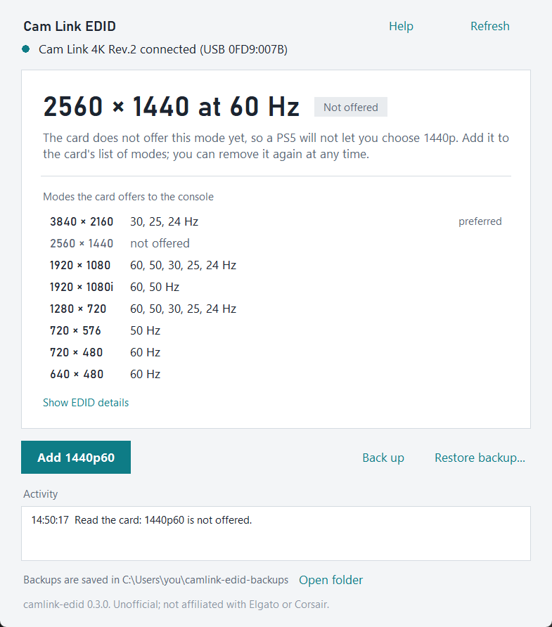
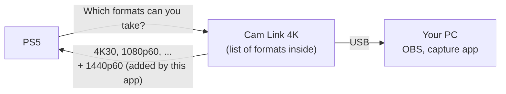
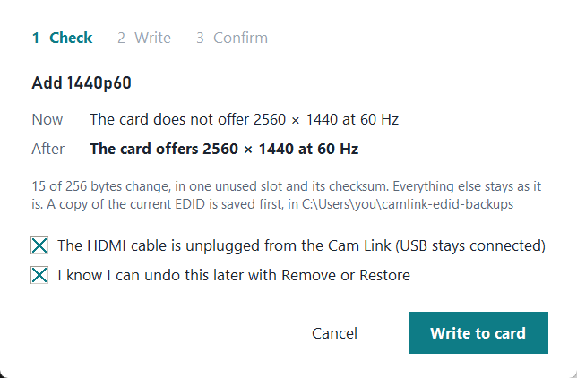
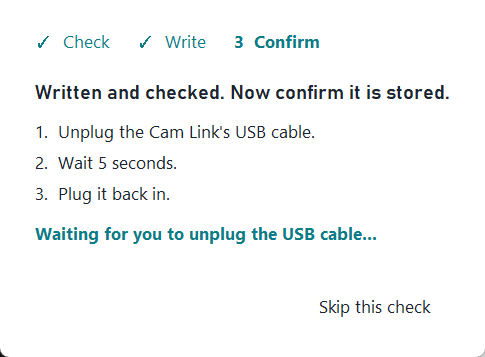
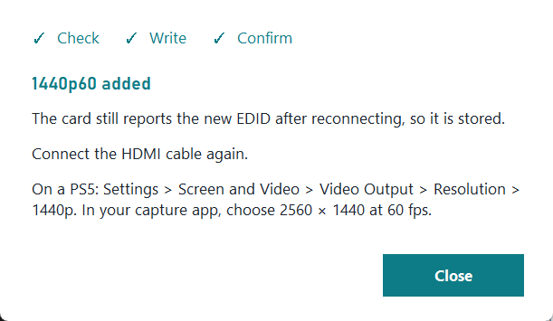

<p align="center">
  
</p>

<h1 align="center">Cam Link EDID</h1>

<p align="center">
  <b>Get 1440p at 60 Hz from a PS5 into an Elgato Cam Link 4K (Rev.2).</b><br>
  One small change inside the card, made safely, and undone with one click.
</p>

<p align="center">
  <a href="https://github.com/why-so-savvy/camlink-edid/releases/latest"></a>
  <a href="https://github.com/why-so-savvy/camlink-edid/actions/workflows/tests.yml"></a>
  
  <a href="LICENSE"></a>
</p>

<p align="center">
  
</p>

> [!IMPORTANT]
> **Unofficial.** Not made, endorsed or supported by Elgato or Corsair.
> It works **only** with the Cam Link 4K **Rev.2** (USB ID `0FD9:007B`) and has been verified on one card so far.
> The app checks your card and refuses anything else.

## Contents

- [The problem, in plain words](#the-problem-in-plain-words)
- [Is this for me?](#is-this-for-me)
- [Step by step](#step-by-step)
- [Undo](#undo)
- [What exactly happens, and where](#what-exactly-happens-and-where)
- [Safety](#safety)
- [I have a different Cam Link](#i-have-a-different-cam-link)
- [FAQ](#faq)
- More: [Troubleshooting](docs/TROUBLESHOOTING.md), [How it works (technical)](docs/HOW-IT-WORKS.md), [The story of this project](docs/PROJECT-STORY.md)

## The problem, in plain words

When you connect a PS5 to a capture card, the PS5 first asks the card: *"Which picture formats can you take?"*
The card answers with a short list stored inside it. That list is called the **EDID**.

The Cam Link 4K Rev.2 can capture **2560 × 1440 at 60 Hz**, but its list does not mention it.
So the PS5 reports that the connected HDMI device does not support 1440p, and never offers it.



This app adds that one missing line to the card's list. Nothing else changes.

## Is this for me?

You need all four of these:

- [ ] An **Elgato Cam Link 4K** whose USB ID is **`0FD9:007B`**. The app tells you this in the first step, so you don't need to know it in advance.
- [ ] A PC with **Windows 10 or 11** and a **USB 3** port.
- [ ] A source that should send 1440p, such as a **PS5**.
- [ ] Five minutes. You'll unplug and replug a cable twice.

Not sure which Cam Link you have? Just run the app (step 1). It only *reads* the card and tells you.
If yours is a different revision, see [I have a different Cam Link](#i-have-a-different-cam-link).

## Step by step

### 1. Download and open the app

1. Open the [**latest release**](https://github.com/why-so-savvy/camlink-edid/releases/latest) and download **`CamLinkEDID.exe`**. There is nothing to install.
2. **Close Elgato Camera Hub**, including its icon next to the clock. It must not talk to the card at the same time.
3. Double-click `CamLinkEDID.exe`.

> [!NOTE]
> Windows may say **"Windows protected your PC"**. Click **More info**, then **Run anyway**.
> This happens because the app is not signed with a paid certificate. GitHub built it from the public code in this repository, and you can [check the file](docs/BUILDING.md#verify-a-download) if you like.

### 2. Check what the app sees

The app reads the card. Reading changes nothing. Look at the top of the window:

| You see | Meaning | What to do |
|---|---|---|
| **Not offered** next to 2560 × 1440 at 60 Hz | Your card is supported and 1440p is missing | Continue with step 3 |
| **Offered** next to 2560 × 1440 at 60 Hz | Already done | Skip to step 4 |
| **This Cam Link is not supported** | A different revision | See [I have a different Cam Link](#i-have-a-different-cam-link) |
| **Connect it to a USB 3 port** | The card runs in slow USB 2 mode | Use a USB 3 port (often blue) and the original cable |
| **Can't read the card** | Usually Camera Hub is still open | Close it fully and click **Refresh** |

### 3. Add 1440p60

Click **Add 1440p60**. A short guide opens.

| **Check** | **Confirm** |
|---|---|
|  |  |

1. **Check:** read what will change.
   - **Unplug the HDMI cable** from the Cam Link (keep USB connected).
   - Tick both boxes and click **Write to card**.
2. **Write:** takes about one second. A backup of your card's original list is saved first.
3. **Confirm:** **unplug the USB cable**, wait 5 seconds and plug it back in. The app reads the card again to prove the change was stored.

When you see **1440p60 added**, you're done.



### 4. Connect the PS5

1. Plug the HDMI cable back into the Cam Link.
2. On the PS5, open **Settings > Screen and Video > Video Output > Resolution** and choose **1440p** (or keep *Automatic*).
3. If the PS5 shows a test screen, let it finish.

### 5. Set up your capture app

In OBS or your capture app, open the Cam Link's settings and choose **2560 × 1440** at **60 FPS**.
The app does not need to stay open, and you never need to run it again: the change lives inside the card.

## Undo

Open the app and click **Remove 1440p60**. Or choose **Restore backup...** and pick a backup file.
Undo works over USB alone, even if there is no picture at all.

Backups are kept in `C:\Users\<you>\camlink-edid-backups`. The oldest file is your card's original. Keep a copy somewhere safe.

## What exactly happens, and where

| | |
|---|---|
| **Where the change is stored** | Inside the Cam Link, in the small chip that answers the PS5's question. Not in Windows, not in OBS, not in the PS5. |
| **What changes** | 15 bytes out of 256, in one *unused* slot of the list, plus a checksum. All existing formats stay exactly as they were. |
| **What is added** | 2560 × 1440 at 59.95 Hz. This exact entry has been accepted by a real PS5. |
| **What the app sends** | Only "read 8 bytes" and "write 8 bytes" requests for that list, the same kind Elgato's own software uses. Nothing touches the card's firmware. |
| **What stays on your PC** | Only the backup files. Nothing runs in the background. |
| **How long it lasts** | Until you change it again. It survives unplugging, restarts and other PCs. A factory reset or firmware update from Elgato *might* restore the original list. If that happens, just add it again. |

The full technical description, with every byte, is in [docs/HOW-IT-WORKS.md](docs/HOW-IT-WORKS.md).

## Safety

**How the app protects your card:**

- It only works on the exact card model it was tested with, `0FD9:007B`.
- It reads the card twice before trusting what it sees.
- It checks every byte of the new list before writing it. The card itself would accept a broken list.
- It always saves a backup first.
- It won't let you write until you confirm the HDMI cable is unplugged.
- It checks each of the 32 small pieces as it writes them and stops at the first sign of trouble. The card only stores the new list after the very last piece, so a stopped write changes nothing.
- It cannot be closed in the middle of writing.
- It reads the card back afterwards, and again after you replug it.

**What it cannot protect against:**

- Pulling the USB cable during the one second of writing. If that happens, run the app again: it shows the state and lets you restore.
- Card revisions or firmware nobody has tested yet. Please [report your result](CONTRIBUTING.md#reporting-a-result).

## I have a different Cam Link

Elgato has made several Cam Link 4K revisions, and confusingly the name **"MK.2"** has been used for two of them.
**Only the USB ID tells you which one you have.**

| USB ID | Model | This app |
|---|---|---|
| `0FD9:007B` | Cam Link 4K Rev.2 (older "MK.2") | ✅ Supported |
| `0FD9:0066` | Cam Link 4K, 1st generation | ❌ Different hardware |
| `0FD9:00A1` | Cam Link 4K Rev.3 | ❌ Not yet known. Most promising candidate |
| `0FD9:00F4` | Cam Link 4K Rev.4 (newer "MK.2") | ❌ Not yet known |
| `1CFA:0011` | Cam Link Pro | Not needed: Elgato's own software offers custom EDID |

**This app is not the right tool for those cards. Please don't try to force it.**
What *can* help: everything learned here is written down. A capable AI assistant (ChatGPT, Claude, Gemini or a coding agent) can use it to help you investigate your own card, carefully and step by step. That is how this project was done.

👉 **[Researching your card with an AI assistant](docs/AI-ASSISTED-RESEARCH.md)** has the safety rules, a plan and a ready-to-paste prompt.

If you get it working, please share what you found so support can be added for everyone.

## FAQ

**Does this make my Cam Link more powerful?**
No. It only tells the PS5 about a format the card could already capture. 1440p at 120 Hz and 4K at 60 Hz remain impossible on this hardware.

**Does it work with an Xbox or a PC?**
Probably, because the new entry is a standard one. Only the PS5 has been tested.

**Does 1440p60 mean my game runs at 60 FPS?**
No. It is the HDMI signal format. The game decides its own frame rate.

**Will it void my warranty?**
It might. The change can be undone, but it is unofficial. See the [disclaimer](#disclaimer).

**Do I need Python?**
No, not for `CamLinkEDID.exe`. Developers can also [run it from source](docs/BUILDING.md).

**Something went wrong.**
See [Troubleshooting](docs/TROUBLESHOOTING.md). Every message in the app is explained there.

## For developers

```powershell
python camlink-edid.py --help                   # command-line version (detect, status, add, remove, restore...)
python -m unittest discover -s tests            # tests against a simulated card, no hardware needed
python packaging/build_exe.py                   # build CamLinkEDID.exe (needs PyInstaller)
```

Only the Python standard library is used. See [docs/BUILDING.md](docs/BUILDING.md) and [CONTRIBUTING.md](CONTRIBUTING.md).

## Credits

- [schlarpc/elgato-cam-link-4k-firmware-re](https://github.com/schlarpc/elgato-cam-link-4k-firmware-re) documented how the Cam Link 4K revisions differ.
- [Everlite/EverLive v1.3.0](https://github.com/Everlite/EverLive/releases/tag/v1.3.0) published the PS5-tested 2560 × 1440 at 59.95 Hz timing (used there on a different capture card).

Made by **why-so-savvy**. Read [how this project came together](docs/PROJECT-STORY.md).

## Disclaimer

This software writes to the memory of your device. It is provided "as is", without warranty of any kind (see [LICENSE](LICENSE)). Use it at your own risk.
Elgato and Cam Link are trademarks of Corsair Memory, Inc. PlayStation and PS5 are trademarks of Sony Interactive Entertainment Inc. They are used only to identify compatible hardware.

## License

[MIT](LICENSE) © 2026 why-so-savvy
